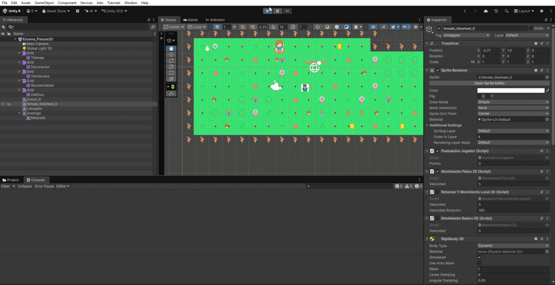
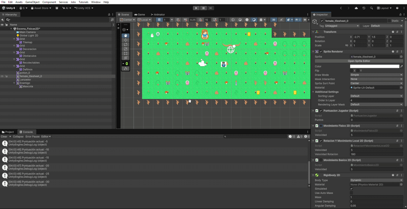

# Práctica: Mapas y físicas 2D en Unity

## Descripción

En esta práctica se ha trabajado con el motor de físicas 2D y el editor de mapas 2D que proporciona Unity.

El objetivo ha sido aprender a utilizar los componentes físicos y las herramientas de creación de mapas para desarrollar un entorno de juego en 2D.

## Componentes utilizados

### Física 2D
- **Rigidbody:** permite acceder a las simulaciones físicas.
- **Collider:** permite detectar las colisiones entre objetos.

### Mapas 2D
- **Grid:** organiza los elementos del mapa mediante una cuadrícula.
- **Tilemap:** permite construir mapas utilizando diferentes tiles.
- **Tile Palette:** facilita la selección y edición de tiles.
- **Tilemap Collider:** detecta las colisiones de los elementos del Tilemap.
- **Composite Collider:** permite combinar diferentes colisionadores.

## Demostración de la práctica

### Física 2D

### Lanzamiento

### Rotación

## Herramientas utilizadas
- Unity
- Motor de físicas 2D de Unity
- Editor de mapas 2D (Tilemap)

## Contenido del proyecto

En este repositorio se incluye el proyecto de Unity correspondiente a la práctica de mapas y físicas 2D, junto con tres GIF que muestran su funcionamiento.
